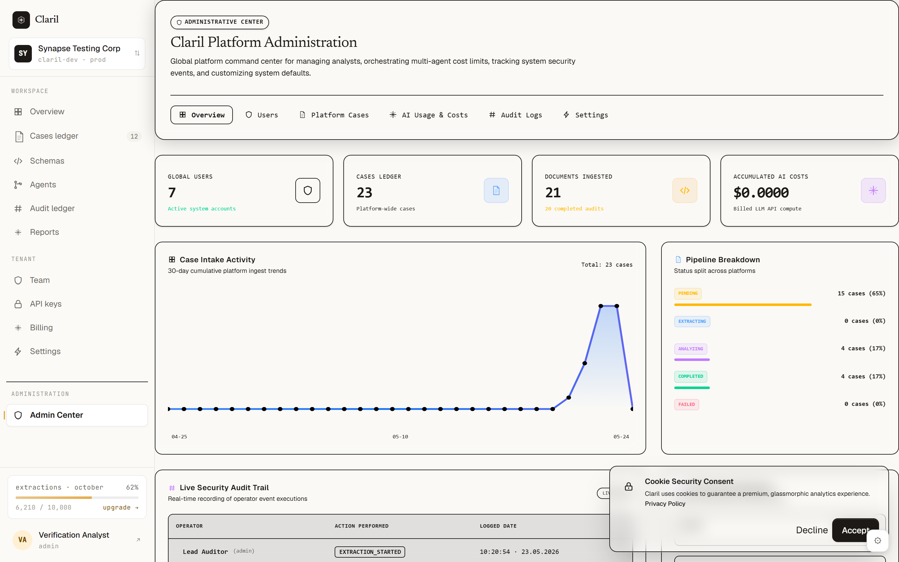
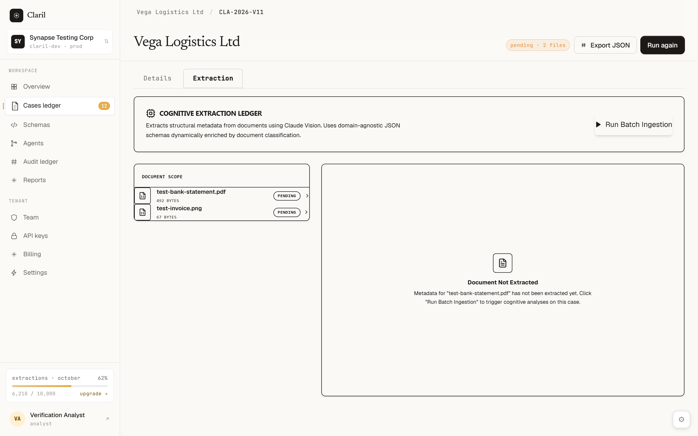
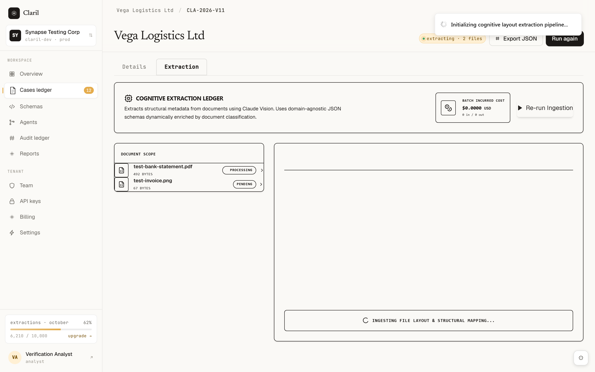
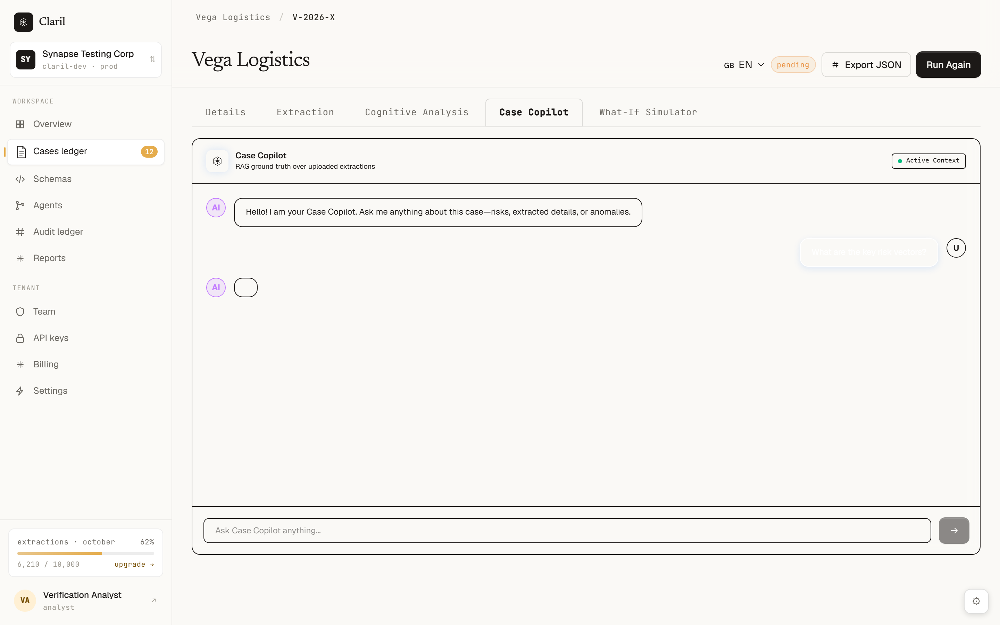
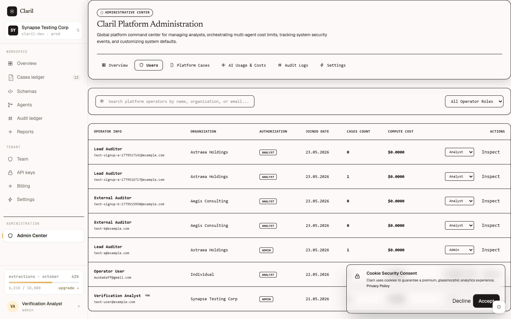
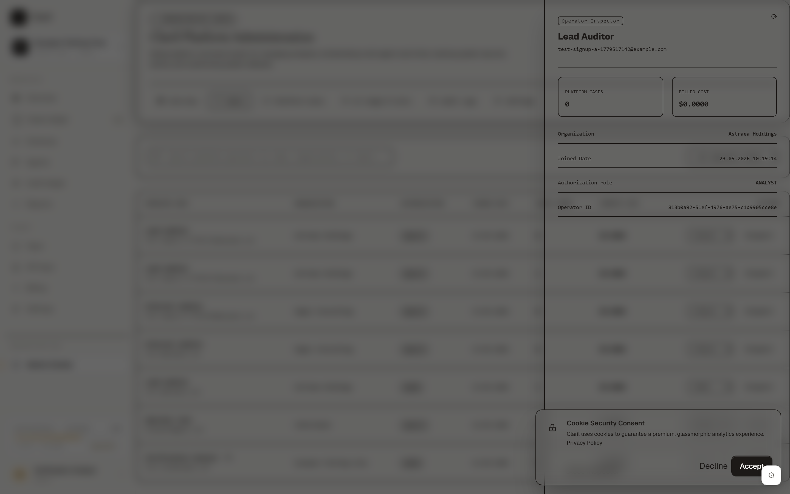
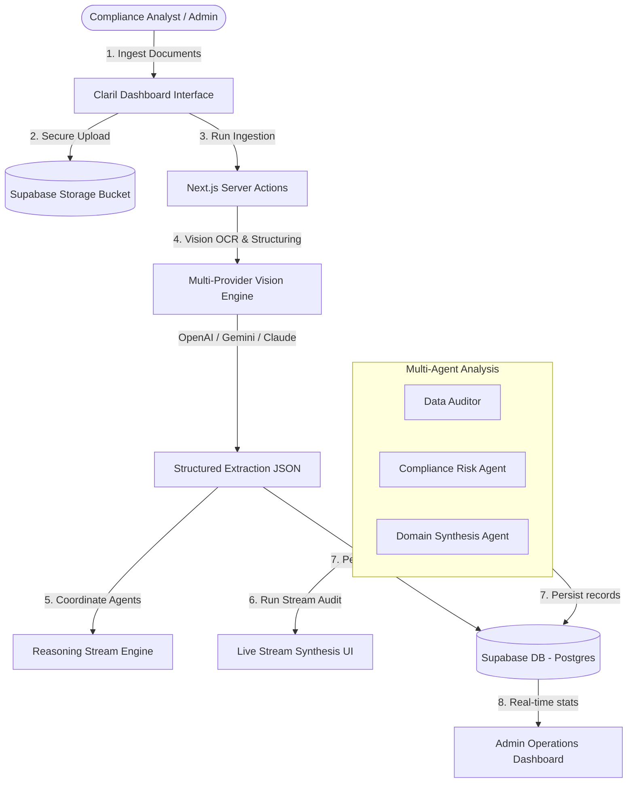

# Claril — Universal Multi-Agent Document Intelligence Platform

<p align="center">
  
</p>

<p align="center">
  <a href="https://nextjs.org/"></a>
  <a href="https://www.typescriptlang.org/"></a>
  <a href="https://supabase.com/"></a>
  <a href="https://tailwindcss.com/"></a>
  <a href="LICENSE"></a>
</p>

---

## 🌟 What is Claril?

**Claril** is a domain-agnostic, production-grade universal document intelligence platform. Driven by an advanced **multi-provider vision AI model** pipeline and coordinate **multi-agent reasoning streams**, Claril bridges the gap between raw document uploads (PDFs, scans, invoices, clinical charts) and audit-ready, structured analysis.

Unlike vertical-specific extraction tools, Claril is built with extreme adaptability. By changing domain schema mappings, the platform instantly morphs from a corporate tax auditing suite into a medical charts summarizer or a mortgage risk assessment ledger. It empowers compliance analysts, financial controllers, and administrators to extract high-fidelity structures, engage in conversational AI chat over multi-file contexts, and track operational workloads down to the cent.

---

## 📸 Platform Showcases

### Multi-Agent Interaction & Analytics
````carousel

<!-- slide -->

<!-- slide -->

<!-- slide -->

````

### Administrative Control Hubs
````carousel

<!-- slide -->

<!-- slide -->

<!-- slide -->

<!-- slide -->

<!-- slide -->

<!-- slide -->

````

---

## ✨ Key Features

* **📁 Secured Multi-Tenant Storage:** Direct document uploads configured on top of **Supabase Storage** with folder-level **Row Level Security (RLS)** isolation.
* **👁️ Multi-Provider Vision AI:** Modular, provider-agnostic engine support for **Anthropic (Claude 3.5 Sonnet)**, **Google (Gemini 1.5 Pro/Flash)**, and **OpenAI (GPT-4o)**. Ingests raw formats and outputs structured JSON structures.
* **🧠 Multi-Agent Analysis Streams:** Real-time reasoning stream coordinating specialized agents—including the Data Auditor, Financial Compliance Officer, and Domain Synthesis Agent—complete with live Markdown reasoning blocks.
* **💬 Conversational AI Chat:** Deep multi-document conversational memory interface for real-time natural language query runs against extracted document fields.
* **🌐 Multilingual by Default:** Immersive internationalization (i18n) framework covering **English (EN)**, **Azerbaijani (AZ)**, and **Turkish (TR)**.
* **👑 Full-Scale Administrative Panel:** Single-pane admin console tracking user profiles, active system-wide cases, token-level API provider usage, system audit logs, and global feature configurations.
* **✨ Premium Design Aesthetics:** Responsive dark/light visual identity emphasizing rich glassmorphism layouts, harmonious HSL palettes, and Framer Motion micro-animations.

---

## 🏗️ System Architecture

Claril features a decupled client-server architecture built on Next.js Server Actions and secure Supabase database bridges:



---

## 🛠️ Technology Stack

* **Core Framework:** [Next.js 15.1.7 (App Router)](https://nextjs.org/) + [TypeScript](https://www.typescriptlang.org/) (Strict Mode)
* **Styling & Components:** [Tailwind CSS v4.0](https://tailwindcss.com/), [shadcn/ui](https://ui.shadcn.com/) primitives, and [Lucide React](https://lucide.dev/) icons
* **Animations:** [Framer Motion v11](https://www.framer.com/motion/) for fluid state micro-animations
* **Authentication & Backend:** [Supabase](https://supabase.com/) (PostgreSQL Database, Auth Core, secure Storage, Realtime Listeners)
* **API Clients:** Official integration SDKs for `@anthropic-ai/sdk`, `@google/generative-ai`, and `openai`
* **Package Manager:** `pnpm` workspace structure

---

## 🚀 Getting Started

A step-by-step walkthrough for local setup. For detailed environment variables, storage setup, and production guidelines, consult the comprehensive [Building and Deploying Guide](docs/BUILD.md).

### 1. Clone & Install Dependencies
```bash
git clone https://github.com/musbabaff/claril.git
cd claril
pnpm install
```

### 2. Configure Environment
Create a copy of our environment example at the project root and populate it with your Supabase credentials and LLM API provider keys:
```bash
cp .env.example .env.local
```

### 3. Initialize Supabase
1. Run the base tables, structure migrations, and extensions using the [AI Features Migration SQL File](MIGRATION_AI_FEATURES.sql) in your **Supabase SQL Editor**.
2. Run user profiles trigger functions and audit log parameters using the [Admin Panel Migration SQL File](MIGRATION_ADMIN_PANEL.sql) in your **Supabase SQL Editor**.
3. Create a **Private Storage Bucket** in your Supabase dashboard named exactly **`documents`**.

### 4. Create Admin Account
In the Supabase SQL Editor, run this query replacing the target email with your registered user's email to bypass middleware gating and open the admin dashboard:
```sql
UPDATE auth.users
SET raw_user_meta_data = coalesce(raw_user_meta_data, '{}'::jsonb) || '{"role": "admin"}'::jsonb
WHERE email = 'admin@example.com';
```

### 5. Launch Development Build
```bash
pnpm dev
```
Open `http://localhost:3000` to interact with Claril.

---

## 📂 Project Structure

```
├── .github/                 # GitHub workflows (CI yml), bug report/PR templates
├── app/                     # Next.js 15 routing, pages, server actions, and middleware
│   ├── api/                 # Secure background AI routes and endpoints
│   ├── dashboard/           # Analyst dashboard (cases, extraction, chat templates)
│   │   └── admin/           # Gate-protected admin panels (audit, usage, config panels)
│   ├── login/               # Portal authentication
│   └── signup/              # Portal organization registration Wizard
├── components/              # Beautiful glassmorphic UI components
│   ├── admin/               # Administrative widgets, tables, settings cards
│   └── ui/                  # Tailored layout fragments and shadcn components
├── docs/                    # Screenshots and building document libraries
│   └── screenshots/         # Core verified product interface captures
├── lib/                     # Supabase clients, multi-agent frameworks, i18n configurations
│   ├── agents/              # Stream-controllers and reasoning-agent schemas
│   ├── supabase/            # Client and server database helpers
│   └── i18n/                # Localization configurations (AZ, EN, TR)
├── public/                  # Static platform branding assets
├── MIGRATION_AI_FEATURES.sql# Base migration queries
├── MIGRATION_ADMIN_PANEL.sql# Operational administrative triggers SQL
├── package.json             # Core dependency management definitions
└── tsconfig.json            # Strict TypeScript rules configuration
```

---

## 🔐 Security & RLS Gating

Claril is built on absolute data isolation principles:
* **Row Level Security (RLS):** Every profile, case, document, and report row in Postgres contains user/org RLS triggers. Users can never read or intercept rows belonging to other registered organizations.
* **Server Action Isolation:** Sensitive API connections to LLM providers are computed strictly server-side. No API keys are ever transferred to or processed on the analyst's client browser.
* **Admin Gate Checks:** Administrative API routers are double-shielded. A global Next.js `middleware.ts` intercept checks authentication status and gates the `/dashboard/admin` routes unless a user has verified `"role": "admin"` session metadata.

---

## 🪙 AI Cost & Usage Controls

Claril treats model costs as a primary operating metric:
* **Token-Level Audit logs:** The platform tracks input and output token consumption for every vision structuring and multi-agent reasoning stream call.
* **Real-time Cost Metrics:** System administrators can track real-time visual charts analyzing aggregate LLM spend per provider or per organization, allowing easy billing limits enforcement.

---

## 📄 License

This project is licensed under the **MIT License** — see the [LICENSE](LICENSE) file for details.

---

## 👤 Author

* **Mustafa Babayev** / **Sydnar Technologies**
* **GitHub:** [@musbabaff](https://github.com/musbabaff)
* **Email:** contact@sydnar.com
